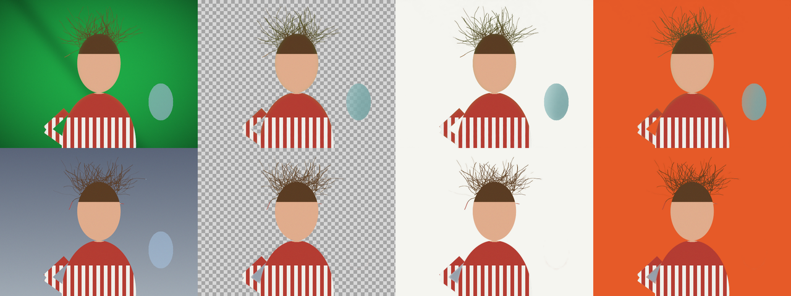

# UltraKey – usuwanie tła i chroma key dla Paint.NET

Efekt do **Paint.NET 5.1+** usuwający tło: dowolne jednolite lub gradientowe tło (biały/szary/studyjny papier)
oraz zielony / niebieski ekran (green screen / blue screen). Zbudowany wokół technik z profesjonalnych keyerów
(Keylight, IBK, matting) zamiast prostej „różdżki”, więc dobrze radzi sobie z włosami, półprzezroczystymi
krawędziami, zieloną poświatą i nierównym oświetleniem.



*Od lewej: oryginał, wynik na przezroczystości, na białym, na pomarańczowym. Góra: Auto na green screenie
z winietą i zagięciem materiału. Dół: Auto na gradientowym tle studyjnym.*

## Co potrafi

| Funkcja | Jak to działa |
|---|---|
| **Auto – wykrywanie tła** | Klastrowanie (k-means w Oklab) kolorów z krawędzi obrazu/zaznaczenia. Kolor uznaje za tło tylko, jeśli występuje na ≥ 2 bokach, więc obiekt ucięty dolną krawędzią (np. portret) nie jest brany za tło. Jeśli wykryje green/blue screen, sam przełącza się na chroma key. |
| **Chroma key (green/blue/dowolny kolor)** | Matowanie różnicą kolorów w świetle liniowym (zasada Keylight/IBK): alfa jest liniowa względem pokrycia, więc włos zakrywający 30 % piksela dostaje alfa ≈ 0,3. Rzeczywisty odcień ekranu jest wykrywany automatycznie. |
| **Korekcja nierównego tła** | Estymacja „czystej płyty” (clean plate): odporna interpolacja push-pull tła za obiektem. Usuwa winietę, gradienty, zagięcia i cienie na ekranie. |
| **Detal krawędzi (włosy, sierść)** | Alfa z projekcji na linię kolorów tło→obiekt + kolorowy guided filter (He i in.), który dopasowuje maskę do prawdziwych krawędzi. |
| **Oczyszczanie koloru krawędzi** | Wielopoziomowa estymacja koloru pierwszego planu (Germer i in., 2020) – z półprzezroczystych pikseli znika kolor starego tła, więc nie ma obwódek na nowym tle. |
| **Despill** | Uogólnione tłumienie poświaty (G dla zielonego, B dla niebieskiego, G+B dla cyjanu …) z zachowaniem jasności. |
| **Ochrona wnętrza obiektu** | Tło zamknięte wewnątrz obiektu (np. biała koszula na białym tle) jest chronione, ale kieszenie tła między włosami są usuwane. |
| **Zachowanie cieni** | Cienie rzucone na tło można zostawić jako półprzezroczystą czerń. |
| **Narzędzia maski** | Docisk tła/obiektu, zmniejsz/powiększ, wygładzenie, usuwanie drobinek i dziur, odwrócenie. |
| **Podglądy** | Przezroczysty wynik, czarno-biała maska, wynik na wybranym kolorze, podgląd kontrolny (czerwone = usunięte). |

Działa na zaznaczeniu: jeśli zaznaczysz prostokąt wokół obiektu, tło jest próbkowane z krawędzi zaznaczenia.
Interfejs jest po polsku, gdy Paint.NET działa po polsku, w pozostałych przypadkach po angielsku.

## Instalacja

1. Pobierz `UltraKey.dll` (zakładka **Actions** → ostatni build → artefakt *UltraKey-plugin*, albo zbuduj sam – niżej).
2. Skopiuj go do `Dokumenty\paint.net App Files\Effects` (utwórz folder, jeśli go nie ma)
   albo do `C:\Program Files\paint.net\Effects`.
3. Uruchom ponownie Paint.NET. Efekt jest w menu **Efekty → Obiekt → UltraKey – usuwanie tła**.

Wymaga Paint.NET **5.1 lub nowszego** (.NET 9).

## Szybki start

- **Zwykłe zdjęcie z jednolitym tłem** – zostaw *Auto* i ewentualnie dostosuj *Tolerancję*.
- **Green / blue screen** – *Auto* wykryje go sam; tryb *Green screen* / *Blue screen* wymusza to samo.
- **Zostaje mgiełka tła** – zwiększ *Tolerancję* albo *Docisk tła*.
- **Dziury w obiekcie** – zmniejsz *Tolerancję*, zwiększ *Docisk obiektu* albo ustaw *Tło zamknięte wewnątrz obiektu → Zostaw*.
- **Włosy** – *Detal krawędzi* 60–100, *Promień dopasowania krawędzi* 3–8.
- Ustaw *Wynik → Maska* albo *Podgląd kontrolny*, żeby dokładnie zobaczyć, co zostało usunięte.

## Budowanie

Potrzebny .NET 9 SDK i pliki Paint.NET (zainstalowany program albo rozpakowany portable ZIP).

```powershell
# Windows
.\build.ps1 -Install                      # buduje i kopiuje do Dokumenty\paint.net App Files\Effects
.\build.ps1 -PdnDir "D:\paint.net"        # inna lokalizacja Paint.NET
```

```bash
# Linux/macOS (cross-build, tak jak w CI)
dotnet build src/UltraKey -c Release -p:PdnDir=/ścieżka/do/rozpakowanego/paint.net
```

### Testy

Algorytm (`src/UltraKey/Core`) nie zależy od Paint.NET, więc jest testowany na dowolnym systemie.
`tests/tools/make_samples.py` generuje sceny z prawdziwą maską (włosy, półprzezroczyste szkło, winieta,
poświata, gradienty), a `tests/run_tests.py` sprawdza błąd maski:

```bash
dotnet build tests/UltraKey.Cli -c Release
pip install pillow numpy
python3 tests/run_tests.py tests/UltraKey.Cli/bin/Release/net9.0/UltraKey.Cli.dll
```

`UltraKey.Cli` przetwarza też pojedyncze pliki PAM (`tests/tools/pam.py` konwertuje PNG ↔ PAM):
`UltraKey.Cli in.pam out.pam Mode=GreenScreen Tolerance=25 Output=Matte`.

## Struktura

```
src/UltraKey/UltraKeyEffect.cs       efekt Paint.NET (UI, renderowanie)
src/UltraKey/Strings.cs              teksty PL/EN
src/UltraKey/Core/Keyer.cs           główny potok
src/UltraKey/Core/ForegroundEstimator.cs  estymacja koloru obiektu/tła
src/UltraKey/Core/GuidedFilter.cs    kolorowy guided filter (kafelkowy)
src/UltraKey/Core/ImageOps.cs        rozmycia, morfologia, push-pull, flood fill
tests/                               harness CLI, generator scen, testy regresyjne
```

---

## English

UltraKey is a background remover / chroma keyer effect for Paint.NET 5.1+. It combines an automatic
background model (border k-means in Oklab with a "seen on at least two sides" rule, auto-switching to chroma
keying for green/blue screens), a linear-light colour-difference matte computed against a robust clean plate,
colour-line projection plus a colour guided filter for hair, multi-level foreground estimation for edge colour
decontamination, generalised despill, enclosed-area protection, shadow keeping and the usual matte controls.
Install by copying `UltraKey.dll` into `Documents\paint.net App Files\Effects`; the effect appears under
**Effects → Object**. Licensed under the MIT license.
